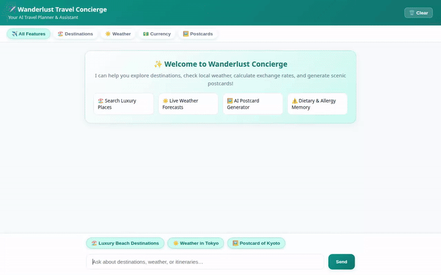

# ✈️ Wanderlust Travel Concierge

An AI-powered travel assistant and itinerary concierge built with the **Google Agent Development Kit (ADK)** and Google Cloud services. Wanderlust helps travelers explore destinations, check live weather, convert currencies, remember allergies across sessions, and generate scenic postcard images and promotional videos.



---

## 🌟 Wired Features & Cloud Services

All capabilities listed below are actively implemented and wired up in this codebase:

- **🧠 Cross-Session Memory Bank (Vertex AI Memory Bank)**
  - Automatically captures, stores, and recalls traveler allergies (food, environmental, medical) and dietary preferences across sessions using `PreloadMemoryTool` and memory generation callbacks.
- **🗄️ Real-Time Travel Catalog (Google Cloud Firestore)**
  - Connects to Firestore to search travel destinations (`search_destinations`), retrieve venue details (`get_destination_details`), and register new spots (`add_destination`).
- **🖼️ AI Postcard Generation (Vertex AI `gemini-3.1-flash-lite-image`)**
  - Generates custom postcard visual artwork for landmarks and scenic locations (`generate_destination_postcard`).
- **🎥 AI Video Generation (Vertex AI `gemini-omni-flash-preview`)**
  - Produces short promotional destination videos in the global region (`generate_destination_video`).
- **☁️ Public Media Storage (Google Cloud Storage)**
  - Uploads generated postcard images and video bytes directly to Google Cloud Storage, saving them as ADK artifacts and returning public HTTPS URLs.
- **🎨 Rich UI Rendering (A2UI v0.8 Basic Catalog)**
  - Emits structured A2UI card layouts (Cards, Columns, Rows, Text, Images) rendered natively in the frontend.
- **☀️ Live Weather Forecasts (Open-Meteo API)**
  - Fetches real-time weather reports and temperatures for any city or landmark worldwide (`get_destination_weather`).
- **💵 Foreign Currency Exchange Rates**
  - Converts travel budget amounts across major global currencies (`get_exchange_rates`).
- **💻 Built-in Python Code Sandbox**
  - Safely executes Python code for budget calculations, route estimations, or data analysis.

---

## 🏗️ Repository Architecture

```text
.
├── app/
│   ├── agent.py            # Main ADK root agent, tools, memory callback, and A2UI setup
│   ├── firestore_tools.py  # Firestore database query tools (search, details, add)
│   ├── image_tools.py      # Postcard image and video generation tools with Cloud Storage upload
│   ├── a2ui_utils.py       # A2UI callback transformer
│   └── app_utils/          # Telemetry and service utilities
├── frontend/
│   ├── main.py             # FastAPI proxy connecting UI to agent over A2A protocol
│   └── static/
│       └── index.html      # Responsive chat interface with category filters & lightbox
├── agents-cli-manifest.yaml# Manifest for agent deployment
├── pyproject.toml          # Project dependencies & environment configuration
├── demo.gif                # Embedded demonstration recording
└── wanderlust_demo.webm    # Source screen recording
```

---

## 🚀 Local Setup & Installation

Follow these steps to run the agent and frontend locally on your machine.

### 1. Prerequisites & Environment Setup

Ensure you have Python 3.11+, `uv` (or `pip`), and Google Cloud SDK (`gcloud`) installed and authenticated.

```bash
# Authenticate with Google Cloud
gcloud auth login
gcloud auth application-default login

# Install Python dependencies
uv sync
```

### 2. Set Environment Variables

```bash
export GOOGLE_CLOUD_PROJECT="<your-gcp-project-id>"
export GOOGLE_CLOUD_LOCATION="us-east1"
```

### 3. Run the Agent Locally

You can test the agent locally using ADK Web:

```bash
agents-cli web
```

### 4. Run the Custom Frontend

To start the custom FastAPI chat frontend:

```bash
cd frontend
pip install -r requirements.txt
python main.py
```

The server starts locally on port `8080`.
